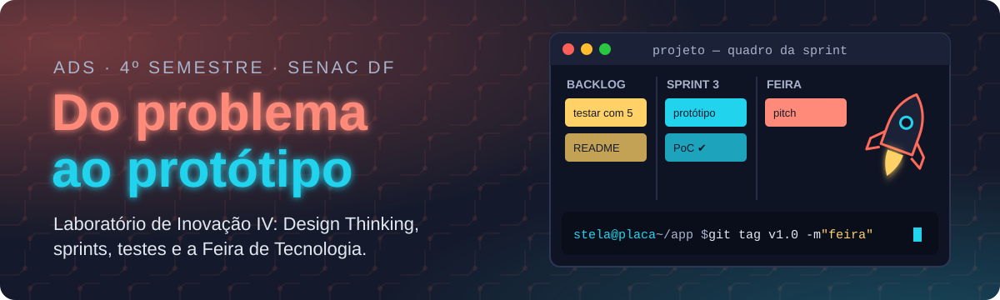

<p align="center">
  
</p>

<p align="center">
  
  
  
  
</p>

<p align="center">
  <b><a href="https://maristelaoliveira.github.io/lab-inovacao-4/">🌐 Abrir o site da disciplina</a></b>
  &nbsp;·&nbsp;
  <b><a href="https://maristelaoliveira.github.io/lab-inovacao-4/#aulas">📚 Ir direto para as aulas</a></b>
  &nbsp;·&nbsp;
  <b><a href="https://maristelaoliveira.github.io/lab-inovacao-4/aulas/aula-03.html">🔍 Design Thinking na prática</a></b>
</p>

---

## `$ git checkout -b do-problema-ao-prototipo`

Prazer, eu sou a **Profa. Maristela**, ou só **Stela**! 👋

Boas-vindas ao **Laboratório de Inovação IV**, do curso de **Análise e Desenvolvimento de Sistemas** da Faculdade de Tecnologia e Inovação Senac DF (4º semestre, noturno, 70 horas).

Este é o momento de juntar tudo o que você aprendeu no curso num projeto real. Cada grupo escolhe um **desafio de verdade** do Senac, do Sesc ou da Fecomércio, entende o problema com **Design Thinking**, organiza o trabalho em **sprints**, constrói um **protótipo funcional** (de preferência com IA), testa com quem vai usar e apresenta na **Feira de Tecnologia**, com a documentação no GitHub.

Este repositório é o **site da disciplina**: o lugar onde ficam as aulas, os estudos de caso, as atividades e tudo o que a gente usa no semestre. Nada de slides: aqui a aula é o próprio site.

```text
stela@placa ~/prototipo $ ./decolar.sh
[1/4] desafio       ✔ um problema real, entendido com Design Thinking
[2/4] sprints       ✔ backlog, prova de conceito e protótipo funcional
[3/4] testes        ✔ quem testa é quem vai usar
[4/4] feira + docs  ✔ apresentação ao público e documentação no GitHub

🚀 3... 2... 1... Feira de Tecnologia!
```

> 📦 Curiosidade: antes de o produto ficar pronto, o Dropbox mostrou num vídeo curto como ele ia funcionar. A lista de espera foi de 5 mil para 75 mil inscritos em uma noite: a ideia estava validada. (Fonte: YourStory.)

---

## 🧭 O que tem no site

| | Seção | Para que serve |
|:-:|---|---|
| 🔬 | **O protótipo** | O raio-x do tema: validar cedo, empatia, testes com usuários, ágil, LGPD e de onde a gente vem (o Radar do Lab II). |
| 📜 | **Ementa e objetivos** | A ementa oficial, palavra por palavra, e aonde a gente quer chegar. |
| 🗺️ | **Quatro unidades** | Aprofundamento das tecnologias, protótipos, Feira de Tecnologia e documentação. |
| 📚 | **Aulas** | Uma página por encontro, com conceitos, estudo de caso, atividade e checklist. |
| 📊 | **Avaliação** | Como a nota é montada. Spoiler: não tem prova, a nota vem do protótipo. |
| 📖 | **Bibliografia** | Os livros para ir além da aula. |
| ♿ | **Acessibilidade** | Tema claro e escuro, aumento de texto (A+) e botão para pausar as animações. |

---

## 🗺️ A trilha do semestre

Quatro unidades, um protótipo. Cada unidade acrescenta uma etapa ao projeto do grupo:

```bash
$ git log --oneline --reverse
a1f0c01  Unidade 1 · aprofundamento das tecnologias        # aulas 1 e 4
b2e9d02  Unidade 2 · protótipos e soluções práticas        # aulas 2, 3, 5 a 8, 10, 11 e 13
c3d8e03  Unidade 3 · Feira de Tecnologia                   # aulas 14 e 16
d4c7f04  Unidade 4 · documentação detalhada das soluções   # aulas 9, 12 e 15
(tag: v1.0) bora apresentar 🎉
```

| Aula | Tema | |
|:-:|---|:-:|
| 01 | Do estudo à solução: conhecendo o Laboratório de Inovação IV | [abrir](https://maristelaoliveira.github.io/lab-inovacao-4/aulas/aula-01.html) |
| 02 | Escolhendo o desafio | [abrir](https://maristelaoliveira.github.io/lab-inovacao-4/aulas/aula-02.html) |
| 03 | Imersão no problema com Design Thinking | [abrir](https://maristelaoliveira.github.io/lab-inovacao-4/aulas/aula-03.html) |
| 04 | Aprofundamento tecnológico e prova de conceito | [abrir](https://maristelaoliveira.github.io/lab-inovacao-4/aulas/aula-04.html) |
| 05 | Ideação, definição da solução e requisitos | [abrir](https://maristelaoliveira.github.io/lab-inovacao-4/aulas/aula-05.html) |
| 06 | Planejamento ágil: histórias, backlog e sprint | [abrir](https://maristelaoliveira.github.io/lab-inovacao-4/aulas/aula-06.html) |
| 07 | Protótipo de baixa fidelidade | [abrir](https://maristelaoliveira.github.io/lab-inovacao-4/aulas/aula-07.html) |
| 08 | Sprint 1 e apresentação da prova de conceito | [abrir](https://maristelaoliveira.github.io/lab-inovacao-4/aulas/aula-08.html) |
| 09 | Entrega do 1º bimestre: registro no Loop e no README.md | [abrir](https://maristelaoliveira.github.io/lab-inovacao-4/aulas/aula-09.html) |
| 10 | Sprint 2: protótipo funcional | [abrir](https://maristelaoliveira.github.io/lab-inovacao-4/aulas/aula-10.html) |
| 11 | Testes com usuários | em breve |
| 12 | Documentação técnica da solução | em breve |
| 13 | Sprint 3: finalização do protótipo | em breve |
| 14 | Ética, segurança e preparação da apresentação | em breve |
| 15 | Ensaio geral e documentação final | em breve |
| 16 | Ajustes finais e ensaio da apresentação | em breve |
| 17 | Apresentação do projeto final | em breve |
| 18 | Avaliação final de recuperação | em breve |

> 📡 **De onde a gente vem:** as tecnologias pesquisadas no [Laboratório de Inovação II](https://maristelaoliveira.github.io/lab-inovacao-2/) (IA, nuvem, IoT, cibersegurança e as outras) ganham aplicação prática aqui, num protótipo para um desafio real do Sistema Fecomércio.

---

## 🛠️ Ferramentas da disciplina

<p align="center">
  
</p>

| Ferramenta | Para quê |
|---|---|
|  **GitHub Pages** | Pôr páginas no ar direto do repositório. |
| 📋 **GitHub Projects e Codespaces** | O quadro das sprints (o time vê o que falta) e o ambiente de desenvolvimento na nuvem. |
| 💻 **VS Code** | Construir o protótipo. |
| 📘 **Microsoft Learn** | Aprofundar a tecnologia do grupo. |
| 🤖 **GitHub Copilot** e **Copilot do Microsoft 365** | Ajudar no código e na escrita, com diário de uso. |
| 💬 **Teams, Loop e Whiteboard** | Combinar, registrar as entregas e fazer a ideação juntos. |
| 🎓 **Moodle** | Entregar as atividades. |

---

## 🤖 IA com consciência

O GitHub Copilot e o Copilot do Microsoft 365 ajudam no código e na escrita, com um **diário do que foi aceito e do que foi corrigido**. E o uso da IA também entra no relato da documentação.

> 🧪 Se a IA escreveu e ninguém testou, não é protótipo: é aposta.

---

## 📊 Como a nota é montada

Dez pontos por bimestre. Aqui não tem prova: a nota vem do protótipo.

| 1º bimestre (10 pontos) | | 2º bimestre (10 pontos) | |
|---|:-:|---|:-:|
| Prova de conceito (atividade avaliativa prática) | 4,0 | Protótipo, Feira de Tecnologia e documentação | 7,0 |
| Entregas com explicação no Loop e no README.md | 6,0 | Avaliação Integrada | 2,0 |
| | | Participação na Jornada Interdisciplinar | 1,0 |

Para ser aprovado: **média final 6,0** e pelo menos **75% de frequência**.

```text
$ git push origin aprovacao
! [rejected]  aprovacao -> aprovacao (frequência abaixo de 75%)
```

> Esse push a gente não quer ver rejeitado. Venha às aulas! 😉

---

## 🙋 Dicas de sobrevivência

1. **Entenda antes de construir.** Curto-circuito? Volte uma etapa: quase sempre o problema estava no entendimento, não no código.
2. **Teste com 5 pessoas, várias vezes.** Cinco usuários já revelam a maior parte dos problemas de usabilidade (Nielsen Norman Group).
3. **Sprint curta, erro pequeno.** Quadro atualizado no GitHub Projects evita a surpresa da véspera.
4. **Colete só o dado que precisa.** Dado pessoal exige cuidado: a LGPD vale para protótipo também.
5. **Documente enquanto faz.** README escrito na madrugada da Feira é o "funcionava na minha máquina" da documentação. 😅

---

<details>
<summary><b>👩‍🏫 Para a professora (estrutura do repositório)</b></summary>

<br>

Site estático publicado no GitHub Pages a partir da branch `main`, sem build e sem dependências.

```text
lab-inovacao-4/
├── index.html              # página da disciplina (protótipo, ementa, unidades, aulas, avaliação, bibliografia)
├── aulas/
│   └── aula-NN.html        # uma página por aula (por enquanto, da 01 à 10)
└── assets/
    ├── css/  js/           # visual comum dos sites da Stela (estilo.css, neon.css, placa.js…) e o aula.css/aulas.js
    └── img/                # ícones das tecnologias (tec/), logo, o foguete e o banner deste README
```

- Aula nova: copie uma `aulas/aula-NN.html` pronta, troque o conteúdo e ligue o link "abrir a aula →" na lista de aulas do `index.html`.
- Os arquivos do visual comum (estilo.css, neon.css, placa.js…) são cópia do portal: edite lá.
- Antes de publicar: testar no navegador, também na largura de celular (390 px).

</details>

---

<p align="center">
  Feito com ♥ e sucata eletrônica pela <a href="https://maristelaoliveira.github.io/">Profa. Maristela</a> · Faculdade de Tecnologia e Inovação Senac DF
  <br>
  <code>git tag v1.0 -m "feira"</code>
</p>
